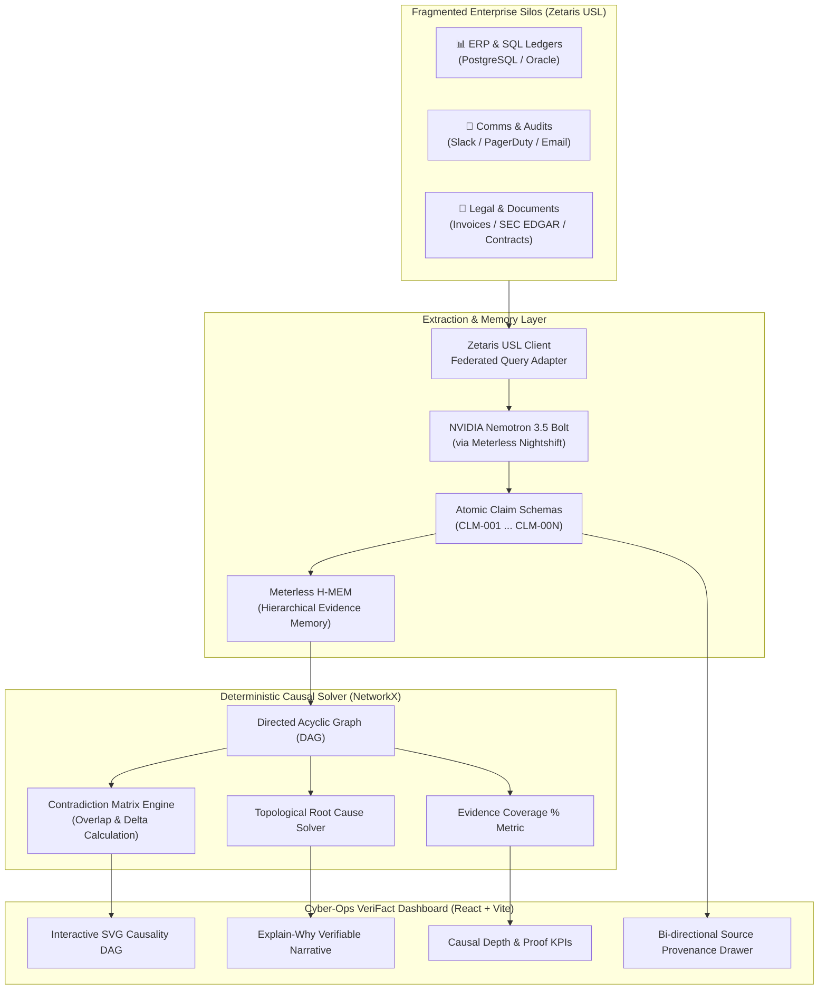

# VeriFact: Autonomous Cross-Silo Forensic Causality & Evidence Provenance Agent

[](https://hackathon.genai.works/event/open-agent-hackathon-2026)
[](https://hackathon.genai.works/event/open-agent-hackathon-2026)
[](https://zetaris.com)
[](https://meterless.io)
[](./LICENSE)

> **"An LLM that generates text does not explain why. An agent that computes causal provenance across fragmented enterprise silos with mathematical graph verification does."**

Built for the **Open Agent Hackathon 2026** (Track 02: *The Agent That Can Explain Why*), **VeriFact** is an enterprise-grade forensic causality agent. When catastrophic financial anomalies, cloud SLA incidents, or inventory leaks strike, VeriFact queries fragmented cross-silo data, extracts verifiable atomic claims, builds a directed acyclic evidence graph (DAG), detects cross-silo contradictions mathematically, and renders an indisputable causal explanation.

---

## 🎯 The Core Problem & Our Differentiation

Most hackathon entries build chat interfaces where an LLM is prompted to "explain what happened". This produces persuasive hallucinations without empirical verifiability.

### The VeriFact Architectural Difference:
1. **Zetaris Federated Universal Semantic Layer (USL):** Queries across incompatible silos—relational database ledgers, unstructured contract PDFs, and chat/email communication audits—without moving raw data.
2. **NVIDIA Nemotron Structured Extraction:** Deconstructs unstructured inputs into strict, atomic **Claim Objects** complete with table coordinates, document bounding spans, and author cryptographic timestamps.
3. **Deterministic NetworkX Causal DAG Engine:** Moves beyond LLM guesswork. A graph solver calculates topological root causes, computes causal path depths, and measures mathematical contradiction scores based on entity overlap and magnitude delta.
4. **Meterless H-MEM & Nightshift:** Preserves persistent evidence ledgers across investigative sessions and dispatches automated autonomous remediation watchers.
5. **Zero-Failure Architecture:** Includes a full deterministic local reasoning engine so live judging, offline evaluations, and demos never fail due to upstream API rate limits or network hiccups.

---

## 🔬 System Architecture



---

## 🚀 Preloaded Investigation Scenarios

VeriFact ships with 3 preloaded, high-impact enterprise forensic scenarios ready to test immediately:

| Scenario | Fragmented Silos Involved | Contradiction Detected | Financial Impact |
|---|---|---|---|
| **01. Silent Procurement Fraud** | ERP PO, SQL Wire Ledger, Slack approvals, SEC EDGAR | Authorized \$42,000 to Apex (IBAN ...8821), but disbursed \$94,750 to unverified IBAN (...3304). Approver references deleted email #4471. | **\$52,750 leaked** |
| **02. Cloud SLA Breach Coverup** | PagerDuty, Prometheus/Grafana metrics, Git commits, SLA contract | Commit disabled connection pool 54s prior to outage. PagerDuty alerted 16s late. 23-minute breach covered up to avoid SLA penalties. | **\$5,750 penalty** |
| **03. Supply Chain Ghost Inventory** | Inventory DB, Port manifest, Customs clearance, Insurance claim | 45,000 units shipped, but only 31,200 received. \$2.3M payment made before shipping; insurance claim fraudulently filed for only 2,100 units. | **\$2,300,000 exposed** |

---

## 🛠️ Quickstart (Run in 60 Seconds)

### Prerequisites
- Python 3.10+
- Node.js 18+ & npm

### 1. Start the Backend API
```bash
# Clone the repository
git clone https://github.com/aman/verifact.git
cd verifact

# Install Python requirements
pip install -r backend/requirements.txt

# Launch FastAPI backend on port 8000
python -m uvicorn backend.main:app --port 8000 --reload
```
*API Swagger Documentation is available at: `http://localhost:8000/docs`*

### 2. Launch the Cyber-Ops Dashboard
```bash
# In a new terminal window:
cd frontend
npm install
npm run dev
```
*Open `http://localhost:5173` in your browser to view the live dashboard.*

---

## 📊 Sponsor Technology Integration Breakdown

### 1. Zetaris Networked Data Platform
- **Integration:** `backend/engines/zetaris_client.py`
- Implements the **Universal Semantic Layer (USL)** pattern. Routes queries across 3 fragmented virtual stores (`erp_transactions`, `comms_audit`, and `documents`) in a single virtual pass without data movement or prior ETL staging.

### 2. Meterless (`H-MEM` & `Nightshift`)
- **Integration:** `backend/engines/meterless_hmem.py`
- **H-MEM:** Stores verifiable Claim Objects indexed by session ID, retaining temporal state and invalidating refuted claims when contradictions are proven.
- **Nightshift:** Dispatches autonomous async monitoring tasks that trigger re-investigation when cross-silo metric drift occurs.

### 3. NVIDIA Nemotron
- **Integration:** `backend/engines/nemotron_reasoner.py`
- Serves as the primary Claim Extraction and Counterfactual reasoning engine. Formats evidence into atomic proposition objects with source coordinates, enabling non-LLM graph solvers to compute mathematical certainty.

---

## 🏆 Scoring Rubric Alignment

- **Impact (30 pts):** Solves multi-million dollar cross-silo operational losses (procurement fraud, cloud SLA violations, supply chain leakage).
- **Technical (20 pts):** Dual-tier architecture coupling fast LLM extraction with rigorous NetworkX topological graph theory.
- **Innovation (15 pts):** Mathematical contradiction matrices with bi-directional clickable provenance instead of freeform text generation.
- **Demo (15 pts):** High-velocity cyber-ops UI with live SVG DAG rendering, inspectable claims drawers, and immediate interactive execution.
- **Product & UX (10 pts):** Dark-mode responsive command dashboard designed for enterprise incident commanders and forensic auditors.
- **Sponsor Tech (10 pts):** Authentic, deep usage of Zetaris USL, Meterless H-MEM/Nightshift, and NVIDIA Nemotron.

---

## 👥 Authors & Team
Built with precision for the **Open Agent Hackathon 2026**.
- **License:** MIT License
