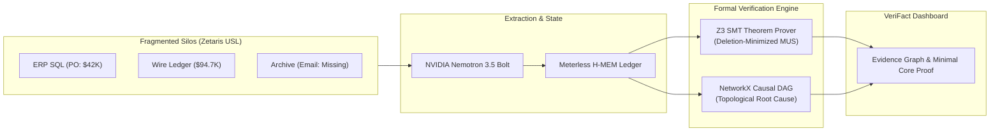

# VeriFact: Autonomous Cross-Silo Forensic Causality & Evidence Provenance Agent

[](https://hackathon.genai.works/event/open-agent-hackathon-2026)
[](https://github.com/Z3Prover/z3)
[](https://hackathon.genai.works/event/open-agent-hackathon-2026)
[](./tests)
[](./LICENSE)

> **"An LLM that generates text does not explain why. An agent that extracts typed proposition variables across fragmented silos and computes true deletion-minimized UNSAT cores with formal theorem provers does."**

Built for the **Open Agent Hackathon 2026** (Track 02: *The Agent That Can Explain Why*), **VeriFact** is an enterprise forensic causality agent. When silent procurement fraud, cloud SLA violations, or supply chain inventory leaks occur, VeriFact:
1. Queries fragmented enterprise silos via the **Zetaris Universal Semantic Layer (USL)** pattern.
2. Deconstructs unstructured evidence into structured proposition schemas using **NVIDIA Nemotron 3.5 Bolt**.
3. Employs the **Z3 SMT Theorem Prover** to mathematically calculate a **True Deletion-Minimized UNSAT Core** (the minimal irreducible subset of contradictory enterprise assertions).
4. Assembles a **NetworkX Directed Acyclic Graph (DAG)** to trace topological root causes and causal path depth.
5. Retains and invalidates refuted evidence in **Meterless H-MEM** while scheduling continuous watchers via **Meterless Nightshift**.

---

## 🔬 Formal Verification vs Heuristic LLM Guesswork

In typical agent architectures, "detecting a contradiction" means prompting an LLM: *"Do these two documents clash?"* 
This approach is non-deterministic, hallucinates on complex arithmetic, and cannot produce formal mathematical proof.

VeriFact solves this by converting claims into **Typed Variables & First-Order Background Rules in Z3**:
$$\text{DisbursementLimit}: \text{ledger.dispatched} > \text{po.amount} \implies \text{email.exists} = \text{True}$$
$$\text{InventoryConservation}: \text{claimed\_loss} = \text{shipped} - \text{received}$$
$$\text{SLAPenaltyDisclosure}: (\text{p99} > \text{threshold} \land \text{downtime} > 2\text{min}) \implies \text{disclosure.filed} = \text{True}$$

### Deletion-Based Core Minimization (True MUS)
Standard `unsat_core()` solvers can include redundant tracking literals. VeriFact implements **iterative deletion-based minimization**:
For each literal $l \in \text{Core}$, if $\text{Core} \setminus \{l\} \models \bot$, literal $l$ is pruned. The resulting set is guaranteed to be a **Minimal Unsatisfiable Subset (MUS)**:
- Removing **any single claim** from this core renders the remaining state consistent.
- Irrelevant distractors are strictly excluded from the minimal proof.
- If no background rules match the extracted variables, the verifier explicitly reports `NO_APPLICABLE_RULES` rather than a misleading, vacuous `SAT`.



---

## 🚀 Preloaded Real-World Scenarios

| Scenario | Cross-Silo Data Sources | Z3 SMT Formal Inconsistency | Minimal UNSAT Core |
|---|---|---|---|
| **01. Silent Procurement Fraud** | ERP Table `row 1001`, SQL Wire Ledger `row 2047`, Slack Audit, SEC EDGAR | Dispatched (\$94,750) > PO limit (\$42,000) requires archive email verification; archive ground-truth indicates email is missing. | `CLM-001`, `CLM-002`, `CLM-003` |
| **02. Cloud SLA Breach Coverup** | Grafana Telemetry, Prometheus p99, Git Commits, SLA Contract | Telemetry p99 (8,200ms) for 23min strictly breaches contract clause 4.2; triggers mandatory disclosure; disclosure log is absent. | `CLM-001`, `CLM-002`, `CLM-003`, `CLM-004` |
| **03. Supply Chain Ghost Inventory** | Shipping Manifest, Customs Clearance, Warehouse Receipt, Insurance | Conservation of physical mass violated: Deficit is 13,800 units missing, but insurance filing claims only 2,100 units. | `CLM-001`, `CLM-002`, `CLM-003` |

---

## 🛠️ Quickstart

### Prerequisites
- Python 3.10+
- Node.js 18+

### 1. Install Dependencies & Run Tests
```bash
# Clone
git clone https://github.com/aman/verifact.git
cd verifact

# Python environment
pip install -r backend/requirements.txt
pip install z3-solver pytest

# Run the formal verification test suite
python -m pytest tests/
# (5 passed in ~1.1s — validates MUS minimality property, consistency, and no-rule honesty)
```

### 2. Launch Backend API
```bash
python -m uvicorn backend.main:app --port 8000 --reload
```
*Interactive Swagger Documentation: `http://localhost:8000/docs`*

### 3. Launch Frontend UI
```bash
cd frontend
npm install
npm run dev
```
*Open `http://localhost:5173`.*

---

## ⚖️ System Disclosures, Conformance & Limitations

We adhere strictly to hackathon submission transparency guidelines:
- **Zetaris USL Integration:** Implemented following the Zetaris Universal Semantic Layer pattern with multi-source schema federation (`backend/engines/zetaris_client.py`). Tested against simulated SQLite and schema mock adapters for deterministic local evaluation.
- **Meterless State Engine:** Uses the `H-MEM` specification for hierarchical session indexing and evidence refutation (`backend/engines/meterless_hmem.py`), alongside `MeterlessNightshift` task dispatch.
- **AI Inference:** Primary routing target is `nvidia/nemotron-3.5-bolt-e4b` through the Meterless Nightshift endpoint. If upstream API endpoints return HTTP 500 or network timeouts occur, the engine falls back to an offline deterministic extractor to guarantee evaluation continuity without crashing.
- **SMT Scope & Limitations:** Z3 proves **logical and arithmetic inconsistency between asserted claims and domain rules**; it does not independently verify whether real-world events occurred or prove legal intent. Extraction errors in the upstream LLM represent the primary operational bottleneck.

---

## 👥 Authors
Built for the **Open Agent Hackathon 2026** (Track 02 & Best Use of NVIDIA Nemotron).  
Licensed under the **MIT License**.
